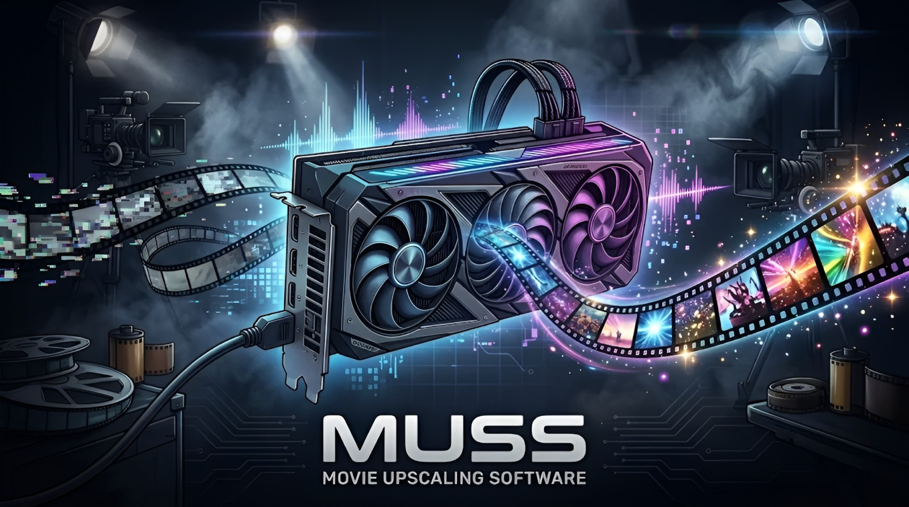
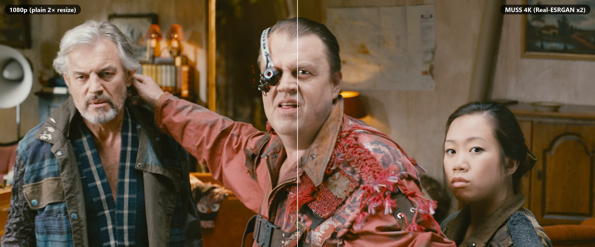
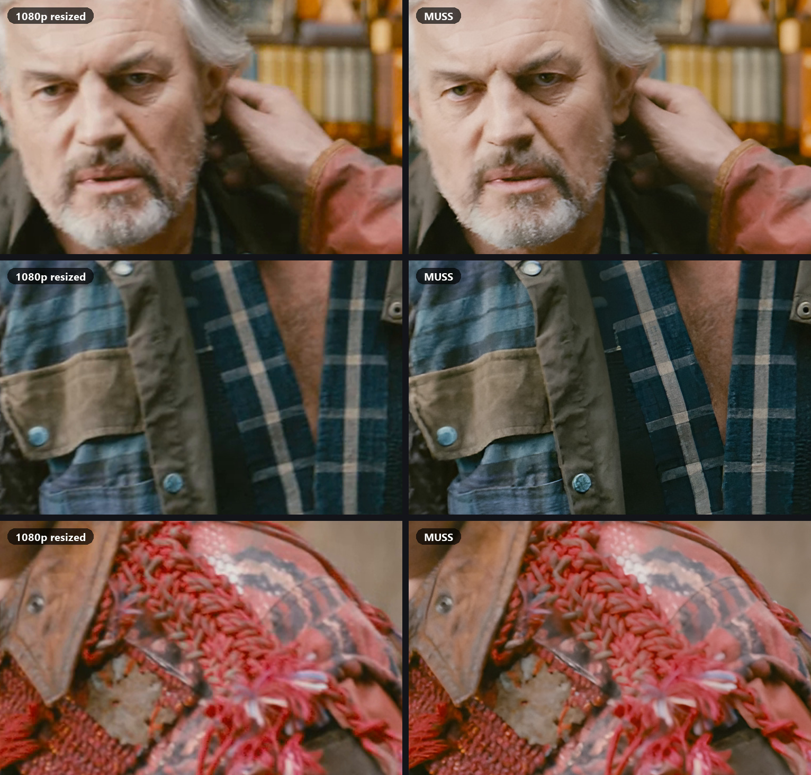

<p align="center"></p>

<p align="center"><a href="https://github.com/MrRobotto512/MUSS/releases/latest"><b>Download MUSS-Setup.exe</b></a> · Windows · NVIDIA RTX</p>

# MUSS — Movie UpScaling Software

A desktop app for AI video upscaling (1080p → 4K) that uses **every NVIDIA GPU you have**, and optionally the GPUs of other PCs on your network.

## Example



Close-ups at 100% (left: the 1080p frame resized to 4K, right: MUSS):



<sub>Upscaled with MUSS v0.2.0 using the built-in Real-ESRGAN x2 model (1920×800 → 3840×1600). Frames from *Tears of Steel*, (CC) Blender Foundation | [mango.blender.org](https://mango.blender.org), licensed under [CC BY 3.0](https://creativecommons.org/licenses/by/3.0/).</sub>

## Features

- **Multi-GPU rendering**: video is split into segments; each GPU decodes, upscales and encodes its own segments, and faster cards automatically take more of the work.
- **GPU end to end**: NVDEC decoding straight into GPU memory, AI on the GPU, RGB→YUV conversion on the GPU, NVENC encoding (HEVC 10-bit, AV1, H.264). Falls back to CPU decoding for formats NVDEC can't handle.
- **NVIDIA TensorRT** acceleration (~1.5–1.7× faster than PyTorch), with engines built once per model, resolution and GPU.
- **Model library**: browse ~600 open-source models from [OpenModelDB](https://openmodeldb.info) inside MUSS — filter by scale, use (live action, anime, restoration), speed and licence — and install them in one click (download verified against OpenModelDB's SHA-256). The catalogue refreshes daily; new models and updates to installed models are flagged.
- **Load any model**: built-in Real-ESRGAN models, plus any `.pth` / `.safetensors` file you add (ESRGAN, Compact, SPAN, SwinIR, HAT, DAT, OmniSR, RealPLKSR, … via [spandrel](https://github.com/chaiNNer-org/spandrel)). Model files are loaded weights-only, so they can't run code. Check each model's licence: many are non-commercial.
- **Audio restoration**: AI rebuilds the high frequencies lost in low-bitrate or old audio (e.g. 128 kbps MP3/AAC, 22–32 kHz audio) up to 24 kHz with [AudioSR](https://github.com/haoheliu/versatile_audio_super_resolution). Works with or without video upscaling — upscale the video, the video and its audio, only a video's audio (picture copied untouched), or plain audio files (MP3, FLAC, WAV, M4A, …). MUSS measures where the treble stops first and leaves full-range audio alone; the original audio below the cutoff is never changed. Runs on all GPUs, resumable. The model (6.2 GB, Apache-2.0) downloads on first use.
- **Preview like a pro**: timeline with filmstrip, in/out preview range, real-time playback of the rendered range, split / side-by-side / original / enhanced compare, zoom and pan.
- **Resume**: stopped, crashed or interrupted exports continue from the last finished segment.
- **Render nodes (optional)**: other PCs running MUSS can render segments over your local network (pairing-code protected). If a node drops out, its work goes back to the queue.
- **Schedule**: run the queue only within a time window (e.g. overnight); it pauses at the end of the window and resumes in the next one.
- **Runs in the background**: closing the window keeps MUSS in the system tray (exports and the schedule continue; notifications when the queue finishes), and it can start with Windows hidden in the tray. The queue is saved and restored across restarts, so a scheduled queue survives a reboot.
- Queue with batch export, range export, quick 10-second tests.

## Requirements

- Windows 10/11, one or more NVIDIA RTX GPUs (RTX 20 series or newer recommended) with a recent driver
- Python 3.14
- `ffmpeg` / `ffprobe` with NVENC: MUSS uses the copy bundled with Topaz Video AI if it is installed, otherwise the ones on your `PATH`

## Install

**Easiest:** download **`MUSS-Setup.exe`** from the [latest release](https://github.com/MrRobotto512/MUSS/releases/latest) and run it. It needs no admin rights and nothing pre-installed: it gets Python 3.14 (via [uv](https://github.com/astral-sh/uv)), Git and an NVENC-capable ffmpeg if you don't have them (checksums verified), installs everything into one folder (default `%LOCALAPPDATA%\Programs\MUSS`, several GB, mostly CUDA PyTorch), and adds Start menu / Desktop shortcuts and an uninstall entry. Start MUSS from the shortcut (`MUSS.exe`).

**From source** (developers):

```bat
git clone https://github.com/MrRobotto512/MUSS.git
cd MUSS
setup.bat
```

`setup.bat` creates `.venv` and installs PyTorch (CUDA 12.8), TensorRT, PySide6 and the other dependencies. Then start the app with **`MUSS.bat`**.

Both kinds of install are git checkouts, so MUSS can update itself.

## Updates

At startup MUSS checks GitHub for a newer release (a version tag such as `v0.3.0`) and shows **Update to v…** in the top bar with the list of changes. **Update and restart** fast-forwards the install to that tag with git and reinstalls Python packages only if `requirements.txt` changed; if that fails it goes back to the previous version. Click the version number in the top bar to check manually; automatic checks can be turned off under **Settings → Updates**. An install with uncommitted local changes is never overwritten.

**Publishing a release** (maintainers): commit your changes, then

```bat
.venv\Scripts\python.exe release.py 0.3.0 "What changed"
```

This sets the version, commits, tags `v0.3.0` and pushes the commit and tag. Pushing to `main` without a tag doesn't update anyone. The tag also triggers the **Build Windows installer** GitHub Actions workflow (`.github/workflows/release.yml`), which builds `MUSS-Setup.exe` with PyInstaller, creates the GitHub release if it doesn't exist and attaches the installer to it.

> `torch` / `torchvision` are pinned to the CUDA builds in `requirements.txt`. Installing other torch-dependent packages without `--extra-index-url https://download.pytorch.org/whl/cu128` can silently replace them with CPU-only builds.

## Render node on another PC

Install MUSS on the other PC, then either switch on **Render node** in the app's top bar or run `Render Node.bat` (`python render_node.py --help` for options). On the main PC add it under **Settings → Render nodes → + Add node** with the address and pairing code it shows. Allow Python through Windows Firewall on private networks. Video is sent unencrypted over your local network.

## Project layout

| Path | What it is |
|---|---|
| `app.py` | The desktop app (PySide6) |
| `timeline.py` | Timeline widget (filmstrip, preview range, playhead) |
| `upscaler/engine.py` | Model cache, frame upscaling, preview rendering |
| `upscaler/export.py` | Segmented, resumable multi-GPU export |
| `upscaler/gpu_io.py` | NVDEC decoding and GPU colour conversion |
| `upscaler/trt_backend.py` | ONNX export and TensorRT engines |
| `upscaler/models.py` | Built-in and custom model handling |
| `upscaler/catalog.py` | OpenModelDB catalogue, verified downloads, model updates |
| `model_library.py` | Model library dialog |
| `upscaler/node.py` | Render node server and client |
| `upscaler/temporal.py` | Experimental temporal stabilizer (not wired in yet) |
| `upscaler/updater.py` | Self-update from GitHub release tags via git |
| `upscaler/audio.py`, `upscaler/audio_job.py` | Audio restoration: cutoff detection, AudioSR chunks, resumable jobs |
| `upscaler/audiosr/` | Inference subset of AudioSR (MIT), adapted to run without its training dependencies |
| `render_node.py` | Headless render node |
| `release.py` | Publishes a new version (maintainers) |
| `installer/` | `MUSS-Setup.exe` (installer) and `MUSS.exe` (launcher) sources, and their PyInstaller build script |
| `.github/workflows/release.yml` | Builds the installer and attaches it to the release on every version tag |

## License

[MIT](LICENSE) for the MUSS code. The example images in `docs/images` are frames from *Tears of Steel* (CC) Blender Foundation | mango.blender.org, licensed under CC BY 3.0, not MIT.

## Third-party components

Included: an inference subset of AudioSR by Haohe Liu (MIT, see `upscaler/audiosr/LICENSE`). Downloaded at runtime or installed as dependencies, not included in this repository: AudioSR 'basic' weights (Apache-2.0), Real-ESRGAN model weights (BSD-3-Clause), PyTorch / torchvision (BSD), spandrel (MIT), PyNvVideoCodec (MIT), NVIDIA TensorRT (NVIDIA license), PySide6 (LGPL-3.0), ffmpeg (LGPL/GPL).
